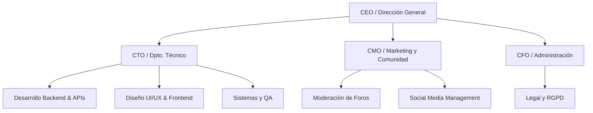

# 01 · Análisis y documentación inicial (RA1)

## 1. Sector y empresas (CE 1a, 1b)

El proyecto se enmarca dentro del sector de entretenimiento digital y software como servicio, concretamente en el nicho de plataformas de catalogación, tracking y comunidades de usuarios para contenido audiovisual.

Clasificación de 5 empresas del sector:

- MyAnimeList: Principal referente en el sector. Ofrece la base de datos más extensa del mercado y foros masivos. Su modelo de negocio se basa en la publicidad intensa, suscripciones premium y venta de datos a productoras.
- AniList: Organización descentralizada/independiente. Ofrece un gestor de anime moderno, de código abierto (API GraphQL) con un fuerte enfoque en el diseño UI/UX y la puntuación de usuarios.
- Kitsu: Startup. Enfoque hiper-social, buscando ser una red social. Monetiza mediante suscripciones (Kitsu PRO) para cambiar temas y avatares.
- TV Time: En desuso desde el 15 de julio de 2026. Era una gran corporación, que aunque no era exclusiva de anime, dominó el sector occidental del tracking audiovisual.
- SIMKL: Empresa mediana. Combina seguimiento de anime, series y películas, destaca por su sincronización a utomáticas con plataformas de streaming populares.

- Funciones por departamento:
    - Dpto. Técnico: Mantenimiento de la BBD, consumo de APIs externas, optimización de tiempos de carga y seguridad de la plataforma.
    - Marketing y Comunidad: Adquisición de usuarios, moderación para hacer un uso correcto de los foros, y fidelización.
    - Administración y Legal: Gestión de ingresos por publicidad/suscripciones, control y costes de servidores, cumplimiento de normativas RGPD
## 2. Necesidades y oportunidades (CE 1c, 1d)

| Prioridad | Necesidad | Criterio de prioridad | Fuente | Enlace del dato |
|---|---|---|---|---|
| 1 (Alta) | Registrar y actualizar el progreso de episodios de forma rápida | Es la función central del proyecto; sin ella la app no resuelve el problema principal | Análisis de soluciones existentes (SOTA) | [01b-sota.md](01b-sota.md) / [MyAnimeList](https://myanimelist.net/) |
| 2 (Alta) | Consultar un catálogo actualizado de animes sin introducir datos a mano | Evita mantenimiento manual y garantiza datos fiables desde el primer día | Documentación técnica de API pública | [Jikan API Docs](https://docs.api.jikan.moe/) |
| 3 (Media) | Filtrar y buscar animes en tiempo real sin recargar la página | Mejora la usabilidad frente a portales lentos o sobrecargados | Quejas frecuentes en comunidades de anime | [Reddit r/anime](https://www.reddit.com/r/anime/) |
| 4 (Baja) | Evitar spoilers en reseñas o comentarios | Factor diferenciador frente a grandes plataformas, pero secundario respecto al tracking básico | Análisis de competencia (SOTA) | [01b-sota.md](01b-sota.md) |

## 3. Tipo de proyecto elegido (CE 1e)

Tipo de proyecto: Aplicación web full-stack (gestor/tracker de anime) con arquitectura cliente-servidor.

Alternativas descartadas:
* Aplicación web orientada en la búsqueda de voluntariado: Aplicación web full-stack centrada en la agrupación de distintos recursos sociales que ofrezcan la opción de hacer voluntariado.
* Desarollo sobre un CMS como Wordpress: Añade una sobrecarga que considero innecesaria, dificulta el uso de MySQL y no se adapta a mi proyecto.

## 4. Requisitos y restricciones (CE 1f)

| ID | Requisito | Tipo (funcional / no funcional / restricción) | Cómo se verifica |
|---|---|---|---|
| RF-01 | El sistema permite registrar usuarios nuevos, iniciar sesión, cerrar sesión y validar contraseñas. | funcional |Registro de un usuario de prueba, verificación en MYSQL y acceso a ruta protegida mediante sesión PHP. |
| RF-02 | El sistema muestra un catálogo paginado de animes consumiendo datos en formato JSON desde una API externa. | funcional | Comprobación en la herramienta para desarrolladores de la respuesta HTTP 200 y renderizado correcto de las tarjetas en pantalla |
| RF-03 | El usuario autenticado puede crear y gestionar sus listas personales (viendo, pendientes, completados, favoritos, listas propias...) | funcional | Inserción, modificación y borrado de registros en la tabla de listas de MySQL reflejados en el perfil del usuario. |
| RF-04 | El usuario puede registrar el número de episodios vistos, la fecha de visionado y una puntuación del 1-10 para cada anime de su lista. | funcional | Actualización asíncrona en base de datos y persistencia de los valores tras recargar la página |
| RNF-01 | Rendimiento: La carga inicial de la vista principal y las búsquedas dinámicas deben responder en menos de 2 segundos. | no funcional | Medición de tiempo de respuesta usando las Herramientas para Desarrolladores |
| RNF-02 | Seguridad: Todas las consultas a MySQL utilizan sentencias seguras y todo el tráfico se sirve cifrado bajo HTTPS. | no funcional | Revisión de código y verificación de certificado SSL activo |
| RNF-03 | Usabilidad: La interfaz se adapta sin desbordamiento horizontal desde móvil hasta escritorio. Interfaz responsive. | no funcional | Pruebas visuales con el modo dispositivo de las Herramientas para Desarrolladores |
| RNF-04 | Accesibilidad: La aplicación mantiene estructura HTML semántica y contraste suficiente según estándares WCAG | no funcional | Puntuación igual o superior a 90 en el apartado Accesibility de Google Lighthouse |
| REST-01 | Plazo: El Hito 1 se entrega el 26/11/26 y el MVP funcional debe estar desplegado para la entrega final de marzo | restricción | Cumplimiento de las fechas de entrega. |
| REST-02 | Tecnología: Backend en PHP y MySQL, frontend en HTML, CSS y JS | restricción | Inspección del repositorio |
| REST-03 | Privacidad: No se almacenan datos de personas reales: se emplean usuarios ficticios y datos públicos de APIs externas | restricción | Revisión de registros y cumplimientos de las leyes de Protección de Datos |

### Matriz de trazabilidad

*Une cada objetivo con sus requisitos, y estos con lo que los implementa y los comprueba. Se rellena por completo al final del proyecto; en H1 basta con **objetivo y requisito**.*

> **Guía.** Ejemplo ficticio: *OBJ-01 Gestionar citas → RF-02 Crear una cita → CU-03 → `POST /citas` → prueba P-07.* Cada RF y cada RNF de la tabla anterior debe aparecer aquí.

### Matriz de trazabilidad

| Objetivo | Requisito | Caso de uso | Pantalla o endpoint | Prueba o indicador |
|---|---|---|---|---|
| OBJ-01 Gestionar el acceso y perfiles de usuario | RF-01 | | | Todos los registros se han completado con éxito |
| OBJ-02 Explorar el catálogo de anime | RF-02 | | | Respuesta correcta por parte de la API |
| OBJ-03 Organizar listas y progreso de visionado | RF-03 | | | Creación de al menos 4 estados de lista (viendo, pendientes, completados, favoritos) y registro de progreso sin errores HTTP 500 ni pérdida de datos en MySQL.  |
| OBJ-03 Organizar listas y progreso de visionado | RF-04 | | | Actualización asíncrona de episodios vistos y puntuación guardada en MySQL tras recargar |
| OBJ-04 Ofrecer una interfaz fluida y sin recargas | RNF-01 | | | Tiempo de carga inicial y búsquedas inferior a 2 s medido en Chrome DevTools (Network) |
| OBJ-05 Garantizar seguridad, usabilidad y accesibilidad | RNF-02 | | | 0 consultas SQL sin sentencias preparadas (PDO) y certificado HTTPS activo |
| OBJ-05 Garantizar seguridad, usabilidad y accesibilidad | RNF-03 | | | 0 desbordamientos horizontales en modo dispositivo de DevTools  |
| OBJ-05 Garantizar seguridad, usabilidad y accesibilidad | RNF-04 | | | Puntuación igual o superior a 90 en el apartado *Accessibility* de Google Lighthouse |

## 5. Obligaciones fiscales, laborales y de prevención (CE 1g)

| Obligación | Por qué le toca | Norma | Estado |
|---|---|---|---|
| IVA e IRPF | Presta servicios digitales y obtiene rendimientos de actividad económica | [Ley 37/1992 (IVA)](https://www.boe.es/buscar/act.php?id=BOE-A-1992-28740) y [Ley 35/2006 (IRPF)](https://www.boe.es/buscar/act.php?id=BOE-A-2006-20764) | sin leer |
| Alta en el RETA | Al trabajar por cuenta propia sin empleados, se debe cotizar en el régimen de autónomos | [Ley 20/2007, Estatuto del Trabajo Autónomo](https://www.boe.es/buscar/act.php?id=BOE-A-2007-13409) | sin leer |
| Protección de datos | La aplicación almacena correos, contraseñas y actividad de los usuarios | [LO 3/2018 (LOPDGDD)](https://www.boe.es/buscar/act.php?id=BOE-A-2018-16673) y [RGPD (UE 2016/679)](https://www.boe.es/doue/2016/119/L00001-00088.pdf) | sin leer |

## 6. Ayudas y subvenciones (CE 1h)

| Campo | Contenido |
|---|---|
| Convocatoria y código | Subvenciones para empresas del Principado de Asturias en la modalidad de Cheques de Innovación y Desarrollo Empresarial, ejercicio 2026 (Agencia SEKUENS) · código BDNS 894180 |
| Fuente y fecha de acceso | [Extracto oficial BOPA en SEKUENS/IDEPA (PDF)](https://www.idepa.es/documents/20147/76120/1.9.Extracto_Convocatoria_Cheques_2026.pdf/857faa5b-949b-cf8e-2dae-5046904cff05) y [Ficha de la ayuda en SEKUENS](https://www.idepa.es/detalle-ayuda/-/asset_publisher/EorU9gEBOv3g/content/ayuda-sekuens-ayudas-a-empresas-del-principado-de-asturias-en-el-marco-del-programa-cheques-de-innovacion-y-desarrollo-empresarial) |
| Quién puede pedirla | Microempresas, pymes y autónomos (empresarios individuales) con centro de trabajo y actividad en el Principado de Asturias y al menos una persona trabajadora (incluido el propio autónomo) |
| Qué cubre / excluye | Cubre servicios externos especializados en transformación digital/TIC (desarrollo de apps o canales digitales, cloud, ciberseguridad, automatización), asesoramiento tecnológico y diseño. Excluye la compra de hardware, licencias de software y gastos con entidades vinculadas |
| Cuánto | 50 % del gasto subvencionable (importes fijos desde 1.250 € hasta un máximo de 7.500 €, sobre un presupuesto máximo de 15.000 €) |
| Plazo | Del 26-mar-2026 al 30-abr-2026 |
| Cómo se pide | Vía telemática a través de la sede electrónica de la Agencia SEKUENS |
| Estado | cerrada |

## 7. Guion de trabajo (CE 1i)

| Fase | Fechas | Tareas principales | Responsable | Hito |
|---|---|---|---|---|
| Análisis | 6-nov a 26-nov | Estudio del sector; requisitos | Yo | H1 26-nov |
| Diseño | 26-nov a 10-dic | Viabilidad; modelo de datos | Yo; el tutor revisa | — |
| Planificación | 10-dic a 21-ene | Iniciación en Backend | Yo | H2 21-ene |
| Implementación | 21-ene a 31-mar | Profundización en Backend | Yo; el tutor revisa | — |
| Pruebas | 1-abr a 23-abr | Plan de pruebas; corrección de fallos | Yo | — |
| Despliegue | 26-abr a 7-may | Puesta en marcha; guía de despliegue | Yo | H3 7-may |
| Seguimiento y cierre | 11-feb a 18-jun | Seguimiento; memoria; defensa | Yo; el tutor evalúa | — |

## 8. Glosario

| Término | Definición | Sinónimos que NO uso |
|---|---|---|
| Catálogo | Conjunto de animes consultables en la aplicación obtenidos desde la API externa. | inventario, biblioteca, repertorio |
| Episodio | Cada una de las partes secuenciales que componen un anime. | capítulo, entrega, tomo |
| Lista personal | Agrupación creada por un usuario para clasificar sus animes según su estado (viendo, pendientes, completados, favoritos). | colección, estantería, carpeta |
| Progreso | Registro del número de episodios vistos y la fecha de visionado de un anime dentro de una lista personal. | avance, tracking, marcado |
| Puntuación | Valoración numérica del 1 al 10 que un usuario asigna a un anime. | nota, calificación, rating |
| Spoiler | Revelación de detalles relevantes de la trama de un anime o episodio que otro usuario aún no ha visto. | destripe, filtración, adelanto |

---

## Criterios de evaluación de este documento (RA1, texto literal)

- **1a)** Se han clasificado las empresas del sector por sus características organizativas y el tipo de producto o servicio que ofrecen.
- **1b)** Se han caracterizado las empresas tipo indicando la estructura organizativa y las funciones de cada departamento.
- **1c)** Se han identificado las necesidades más demandadas a las empresas.
- **1d)** Se han valorado las oportunidades de negocio previsibles en el sector.
- **1e)** Se ha identificado el tipo de proyecto requerido para dar respuesta a las demandas previstas.
- **1f)** Se han determinado las características específicas requeridas al proyecto.
- **1g)** Se han determinado las obligaciones fiscales, laborales y de prevención de riesgos y sus condiciones de aplicación.
- **1h)** Se han identificado posibles ayudas o subvenciones para la incorporación de nuevas tecnologías de producción o de servicio que se proponen.
- **1i)** Se ha elaborado el guión de trabajo que se va a seguir para la elaboración del proyecto.
