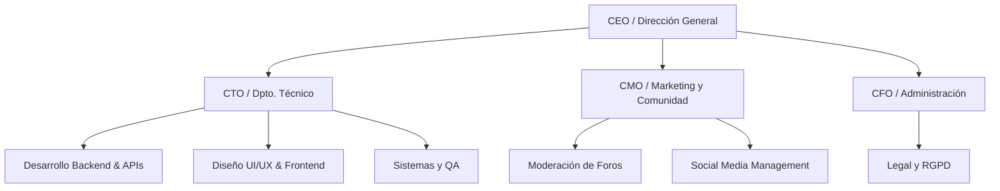

# 01 · Análisis y documentación inicial (RA1)

## 1. Sector y empresas (CE 1a, 1b)

El proyecto se enmarca dentro del sector de entretenimiento digital y software como servicio, concretamente en el nicho de plataformas de catalogación, tracking y comunidades de usuarios para contenido audiovisual.

Clasificación de 5 empresas del sector:

- MyAnimeList: Principal referente en el sector. Ofrece la base de datos más extensa del mercado y foros masivos. Su modelo de negocio se basa en la publicidad intensa, suscripciones premium y venta de datos a productoras.
- AniList: Organización descentralizada/independiente. Ofrece un gestor de anime moderno, de código abierto (API GraphQL) con un fuerte enfoque en el diseño UI/UX y la puntuación de usuarios.
- Kitsu: Startup. Enfoque hiper-social, buscando ser una red social. Monetiza mediante suscripciones (Kitsu PRO) para cambiar temas y avatares.
- TV Time: En desuso desde el 15 de julio de 2026. Era una gran corporación, que aunque no era exclusiva de anime, dominó el sector occidental del tracking audiovisual.
- SIMKL: Empresa mediana. Combina seguimiento de anime, series y películas, destaca por su sincronización a utomáticas con plataformas de streaming populares.

- Funciones por departamento:
    - Dpto. Técnico: Mantenimiento de la BBD, consumo de APIs externas, optimización de tiempos de carga y seguridad de la plataforma.
    - Marketing y Comunidad: Adquisición de usuarios, moderación para hacer un uso correcto de los foros, y fidelización.
    - Administración y Legal: Gestión de ingresos por publicidad/suscripciones, control y costes de servidores, cumplimiento de normativas RGPD
## 2. Necesidades y oportunidades (CE 1c, 1d)

1. **Protección estricta contra spoilers**: Los usuarios dejan de leer un foro por miedo a destripes de la trama. Prioridad media.
2. **Fluidez y carga dinámica**: Las bases de datos actuales son pesadas y requieren múltiples recargas de página para marcar un episodio. Prioridad alta.
3. **Alertas pasivas y nativas**: Los usuarios olvidan cuándo se emiten nuevos episodios y quizá no quieran depender del correo electrónico. Prioridad media.

**Oportunidades de negocio:**
El mercado global de la animación japonesa es uno de los de mayor crecimiento en la industria del entretenimiento. En 2023, el mercado global del anime fue valorado en 31.230 millones de dólares, con una proyección de seguir creciendo en los próximos años, según el informe de mercado de Anime realizado por Grand View Research en el año 2024. Esto genera un público cautivo masivo con altas probabilidades de, al menos plantearse una vez, usar una herramienta como un gestor o una wiki para organizar su consumo.

## 3. Tipo de proyecto elegido (CE 1e)

Durante la fase inicial de este proyecto, valoré como idea principal el desarrollar una aplicación webe enfocada en el ámbito social. Sin embargo, bajo el criterio de pensar qué esa idea no se sostendría a largo plazo, decidí descartar esa vía y apostar por KarasuSync por dos razones:

1. Acotación del alcance y viabilidad: Los proyectos orientados a problemáticas sociales del mundo real pueden abarcar muchos colectivos y muchas situaciones, KarasuSync resuelve y se centra solo en un problema cotidiano muy específico.
   
2. Ajustado a mi perfil profesional: Aunque me hubiera gustado hacer algo relacionado con lo social, pienso que esa alternativa se basaba casi exclusivamente en un sistema de permisos y roles en BBDD. KarasuSync está planteado para hacer uso de un abanico mucho más completo de las competencias del ciclo. 

## 4. Requisitos y restricciones (CE 1f)

*Características que debe cumplir el proyecto, redactadas de forma **verificable** (no «debe ser rápido», sino «responde en menos de 2 s»). Parte de lo que has encontrado en [`01b-sota.md`](01b-sota.md).*

> **Guía.** Numera los requisitos **funcionales** como **RF-01, RF-02…** (qué hace el sistema) y los **no funcionales** como **RNF-01…** (cómo lo hace: rendimiento, seguridad, usabilidad, disponibilidad, accesibilidad). Las **restricciones** (plazo, presupuesto, tecnología obligatoria, normativa) como **REST-01…**. Cada requisito debe tener **una medida o una prueba**. Si aún no sabes cómo lo probarás, escribe «pendiente» y complétalo antes de H3.

| ID | Requisito | Tipo (funcional / no funcional / restricción) | Cómo se verifica |
|---|---|---|---|
| RF-01 | [RELLENAR] | funcional | |
| RNF-01 | [RELLENAR] | no funcional | |
| REST-01 | [RELLENAR] | restricción | |

### Matriz de trazabilidad

*Une cada objetivo con sus requisitos, y estos con lo que los implementa y los comprueba. Se rellena por completo al final del proyecto; en H1 basta con **objetivo y requisito**.*

> **Guía.** Ejemplo ficticio: *OBJ-01 Gestionar citas → RF-02 Crear una cita → CU-03 → `POST /citas` → prueba P-07.* Cada RF y cada RNF de la tabla anterior debe aparecer aquí.

| Objetivo | Requisito | Caso de uso | Pantalla o endpoint | Prueba o indicador |
|---|---|---|---|---|
| OBJ-01 [RELLENAR] | RF-01 | | | pendiente |

## 5. Obligaciones fiscales, laborales y de prevención (CE 1g)

*Las obligaciones que aplican a tu proyecto, **con su norma** y sus condiciones.*

## 6. Ayudas y subvenciones (CE 1h)

*Al menos **una** ayuda real: fuente, requisitos y plazo.*

## 7. Guion de trabajo (CE 1i)

*Fases, hitos y responsables del proyecto. Puede enlazar al tablero de GitHub Projects.*

## 8. Glosario

*Una cosa, un nombre: define los términos del dominio y de tu proyecto, y anota los sinónimos que **no** vas a usar en ningún documento. Con **5 términos** basta; crece con el proyecto.*

| Término | Definición | Sinónimos que NO uso |
|---|---|---|
| [RELLENAR] | | |

---

## Criterios de evaluación de este documento (RA1, texto literal)

- **1a)** Se han clasificado las empresas del sector por sus características organizativas y el tipo de producto o servicio que ofrecen.
- **1b)** Se han caracterizado las empresas tipo indicando la estructura organizativa y las funciones de cada departamento.
- **1c)** Se han identificado las necesidades más demandadas a las empresas.
- **1d)** Se han valorado las oportunidades de negocio previsibles en el sector.
- **1e)** Se ha identificado el tipo de proyecto requerido para dar respuesta a las demandas previstas.
- **1f)** Se han determinado las características específicas requeridas al proyecto.
- **1g)** Se han determinado las obligaciones fiscales, laborales y de prevención de riesgos y sus condiciones de aplicación.
- **1h)** Se han identificado posibles ayudas o subvenciones para la incorporación de nuevas tecnologías de producción o de servicio que se proponen.
- **1i)** Se ha elaborado el guión de trabajo que se va a seguir para la elaboración del proyecto.
